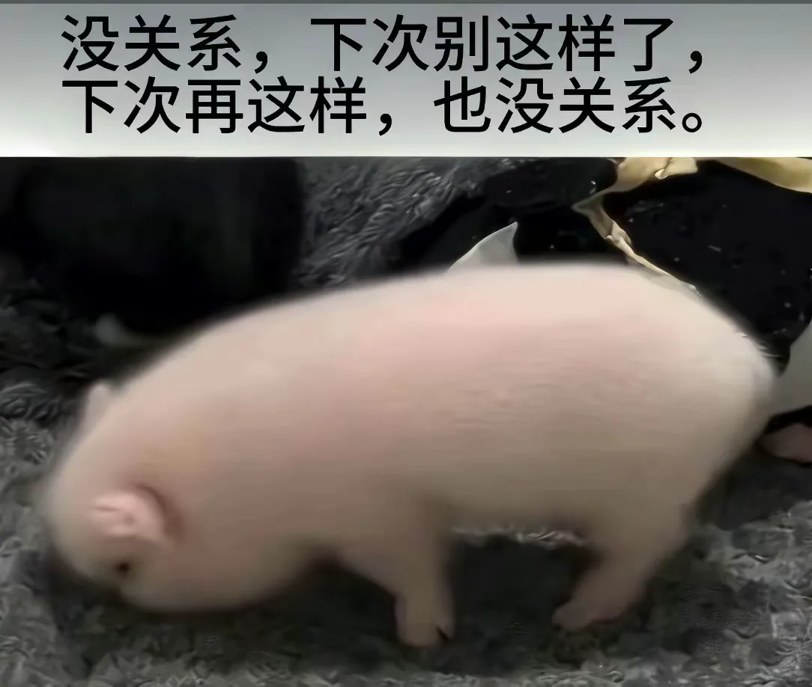

`....miss`

《开始懂了》 .

《我怀念的》.

《我不难过》.

我始终相信缘分，可我越想拉紧我们之间的关系网，却伤了彼此😔。怎么解决心中的困惑！嘴上说着解开了心结，怎么还越陷越深了

~~我曾想过好好经营一段情感，可我…我怎么会在情感上变得懦弱了，我到底在害怕什么。什么都没讲清楚，模糊的难过着，内耗ing。~~

大抵是习惯了一个人 总担心突然闯进生活，打扰了平静的生活，怎么变得平静？来年又是一春，四季更迭，马路边金灿灿的落叶🍂在叮嘱我“人生课题又换了”。我好像完全变了，不像大学一年级那样不惧一切，闷头就是莽。我开始变得遇事先考虑后果，矛盾，爱纠结，害怕突如其来。这是我的心理历程在变化吗？这无疑是糟糕的。我想我变陌生了，不熟悉自己，我要找回来！找回“他们”。

回想自己这段坦途坎坷的情感经历，我学到了很多。精神世界极其的丰富，以至于在现在的我回想起点点滴滴，我会觉得很开心🥰。这无疑是幸福的。\~\~有过一段经历就够了吗，不够不够不够。\~\~我害怕失去，可却是我一手造成的局面。我真糟糕，像一个滚烫的石子掉进ta平静生活的湖面，激起很大的浪花，可又惋惜自己这颗石子不够炽热滚烫，仅仅激起浪花 ，没能够成为'定海神针'。🫤这颗石子却还在层层掀起小小的涟漪。成了碍脚石。或许我不该过多过问ta的生活，可是我是真的舍不得。按ta描述的来说，不甘。爱像反季节，总是后知后觉。

彼此都在逃避，最终缘分真的还可靠吗 恳请上天出手，命运怜悯我 我打赌ta三天之内不会主动找我，很明白，我被抛弃了。你被抛弃，（_~~这算是心梗吗？我有这种感觉还是难过的很深很深，不开心的感觉，失望透顶~~_）显而易见了，是天气变冷了的原因吗，泠空气积攒多了，回头都成了奢望。以为早已放过自己

似乎没人会主动去打扰那个不喜欢的人，无关ta的事。心疼我的也该明白（_~~原来这种心绞的感觉是我在心疼我自己~~_）

是我太过于平庸，始终没能搞懂离别的理由。是我舍不得，ta已经走得很远了，90℃的绝对垂直线慢慢开始发生偏转，我到底该怎样忘记ta，记住ta，思念偏偏不讲道理，我怕会想ta，回想ta

我的主动权用了，似乎什么也没发生。💢*昙花一现，能见则见，既不想见，何须再见* **既许一人以偏爱，愿尽余生之慷慨📷**

~~天气转凉，注意保暖，是你，也是我~~
